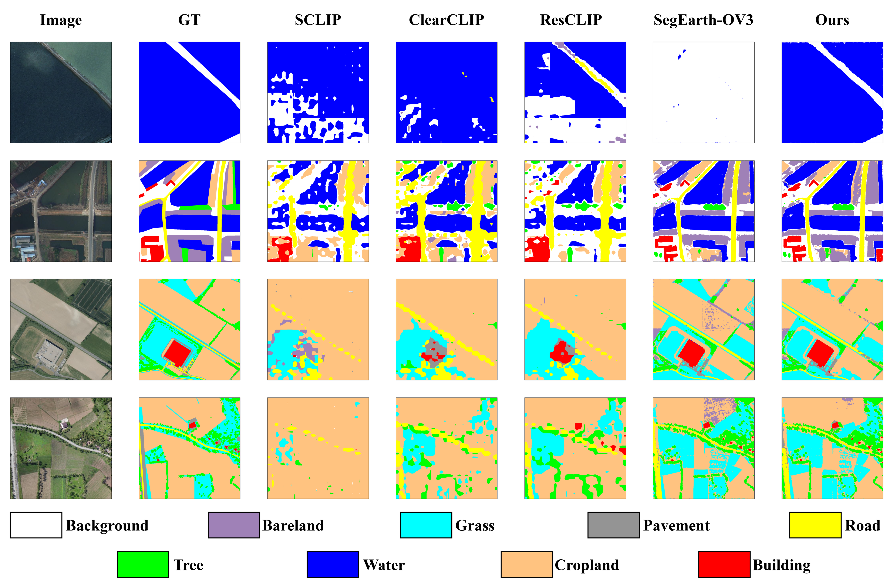

<div align="center">

<h1>CPR-SAM3</h1>
<h3>Complementary Prediction Reconciliation for Training-Free<br>Remote-Sensing Open-Vocabulary Semantic Segmentation</h3>

<p>
Huasong Chen<sup>1</sup>, Wenting Li<sup>2</sup>, Chuihao Meng<sup>1</sup>,
Tianzuo Nie<sup>1</sup>, Yongjun Zhang<sup>1</sup>
</p>
<p><sup>1</sup>Guizhou University &nbsp; <sup>2</sup>Guizhou University of Commerce</p>

[Overview](#overview) | [Results](#results) | [Installation](#installation) | [Datasets](#datasets) | [Usage](#usage) | [Citation](#citation)

</div>

## Overview

Code for **CPR-SAM3**, a training-free method for remote-sensing open-vocabulary
semantic segmentation. We collect candidate labels from SAM3's heads, decoder
layers, and an aligned view, then use DINOv3 appearance prototypes to resolve
conflicting predictions. Both models are frozen. The prototypes are built from
unlabeled reference images.

[](assets/framework.png)

The method has three stages: complementary candidate recovery (CCR),
cross-foundation visual verification (CFVV), and reliability-constrained
reconciliation (RCR).

## Results

Semantic segmentation results (mIoU, %). The baseline is SegEarth-OV3.

| Dataset | Baseline | CPR-SAM3 |
| :--- | ---: | ---: |
| Vaihingen | 60.76 | **62.93** |
| Potsdam | 57.85 | **60.15** |
| LoveDA | 47.37 | **49.59** |
| OpenEarthMap | 44.10 | **47.23** |
| Mean | 52.52 | **54.98** |

Results and figures are from the manuscript. This release has passed CPU tests;
end-to-end GPU reproduction is pending. See [implementation and evaluation notes](docs/REPRODUCIBILITY.md).

<details>
<summary>Qualitative comparisons on OpenEarthMap</summary>



Comparison with SCLIP, ClearCLIP, ResCLIP, and SegEarth-OV3.

</details>

## Installation

The experiment environment used **Python 3.12.13, PyTorch 2.10.0+cu128,
TorchVision 0.25.0+cu128, and MMCV 2.1.0** on Linux. Start with:

```bash
conda create -n cpr-sam3 python=3.12.13 -y
conda activate cpr-sam3
python -m pip install torch==2.10.0 torchvision==0.25.0 --index-url https://download.pytorch.org/whl/cu128
```

Clone the code and external source trees:

```bash
git clone https://github.com/Libai247/CPR-SAM3.git
cd CPR-SAM3
git clone https://github.com/earth-insights/SegEarth-OV-3.git third_party/SegEarth-OV-3
git -C third_party/SegEarth-OV-3 checkout 87e5cc18c8bc9c0b4713b975587281ac1c97c79a
git clone https://github.com/facebookresearch/dinov3.git third_party/dinov3
```

Install **full MMCV 2.1.0 with compiled ops** using the
[environment setup instructions](docs/ENVIRONMENT.md#mmcv), then install the
remaining dependencies:

```bash
python -m pip install -r requirements.txt
```

The recorded MMCV build has CPU ops; SAM3 and DINOv3 still run on the GPU.
`mmcv-lite` is not a substitute. The pinned SegEarth-OV3 checkout supplies the
SAM3 source used by the adapter, so a separate SAM3 installation is not required.
See [Environment](docs/ENVIRONMENT.md) for the recorded versions and build details.

Download the checkpoints separately:

| Model | Checkpoint source |
| :--- | :--- |
| SAM3 (not SAM3.1) | [Official model repository](https://huggingface.co/facebook/sam3) |
| DINOv3 ViT-L/16, LVD-1689M | [Official pretrained models](https://github.com/facebookresearch/dinov3#pretrained-models) |

Copy [paths.example.json](paths.example.json) to `paths.json` and edit its five
paths. `sam3_bpe` points to SAM3's `bpe_simple_vocab_16e6.txt.gz` tokenizer file.
Relative paths are resolved from the JSON file. The DINOv3 SAT-493M checkpoint
is a different model and is not used by these profiles.

```bash
cp paths.example.json paths.json
# Edit paths.json to match your local files.
python tools/doctor.py --paths paths.json
```

## Datasets

We provide profiles for Vaihingen, Potsdam, LoveDA, and OpenEarthMap.
Follow [Data Preparation](docs/DATASETS.md) for downloads, preprocessing, and
label mappings.

| `--dataset` | `--data-root` | RGB reference directory |
| :--- | :--- | :--- |
| `vaihingen` | `data/Vaihingen` | `img_dir/val` |
| `potsdam` | `data/Potsdam` | `img_dir/val` |
| `loveda` | `data/LoveDA` | `img_dir/val` |
| `openearthmap` | `data/OpenEarthMap` | `val/images` |

Reference directories in the last column are relative to the dataset root.

## Usage

Run the commands below from the repository root. They use Vaihingen as an
example; each dataset needs its own prototype bank.

### 1. Build the Prototype Bank

Build a bank from unlabeled reference images for the selected dataset:

```bash
python build_prototypes.py --dataset vaihingen \
  --images data/Vaihingen/img_dir/val \
  --output artifacts/vaihingen_lvd.pt
```

The default uses at most 64 images and up to three prototypes per class.
The bank's JSON sidecar records the selected images and settings. This example
uses the unlabeled evaluation images, a **transductive** setting. Use a separate
reference split for image-disjoint evaluation. No annotation masks are read.

### 2. Single-Image Inference

```bash
python demo.py --dataset vaihingen \
  --image data/Vaihingen/img_dir/val/IMAGE.png \
  --bank artifacts/vaihingen_lvd.pt --output-dir work_dirs/demo
```

Replace `IMAGE.png` with an existing image. The output directory contains
`prediction.png` (class IDs), `prediction_rgb.png`, and `run.json`.

### 3. Evaluation

```bash
python eval.py --dataset vaihingen --data-root data/Vaihingen \
  --bank artifacts/vaihingen_lvd.pt --work-dir work_dirs/vaihingen
```

To evaluate the SegEarth-OV3 baseline, replace `--bank ...` with `--baseline`.
Results and logs are saved under `--work-dir`. Use the same data and class
mapping for both methods.

The model entry point is [cpr_sam3/model.py](cpr_sam3/model.py); benchmark
profiles and text prompts are in [configs](configs). All three commands accept
`--paths` and `--help`.

## Citation

```bibtex
@misc{chen2026cprsam3,
  title  = {CPR-SAM3: Complementary Prediction Reconciliation for Training-Free Remote-Sensing Open-Vocabulary Semantic Segmentation},
  author = {Chen, Huasong and Li, Wenting and Meng, Chuihao and Nie, Tianzuo and Zhang, Yongjun},
  year   = {2026},
  note   = {Unpublished manuscript},
  url    = {https://github.com/Libai247/CPR-SAM3}
}
```

## Acknowledgements

This implementation builds on [SegEarth-OV3](https://github.com/earth-insights/SegEarth-OV-3),
[SAM3](https://github.com/facebookresearch/sam3),
[DINOv3](https://github.com/facebookresearch/dinov3), and
[MMSegmentation](https://github.com/open-mmlab/mmsegmentation).
We thank their authors for sharing their work. See [third-party notes](docs/THIRD_PARTY.md)
for source and asset information.
